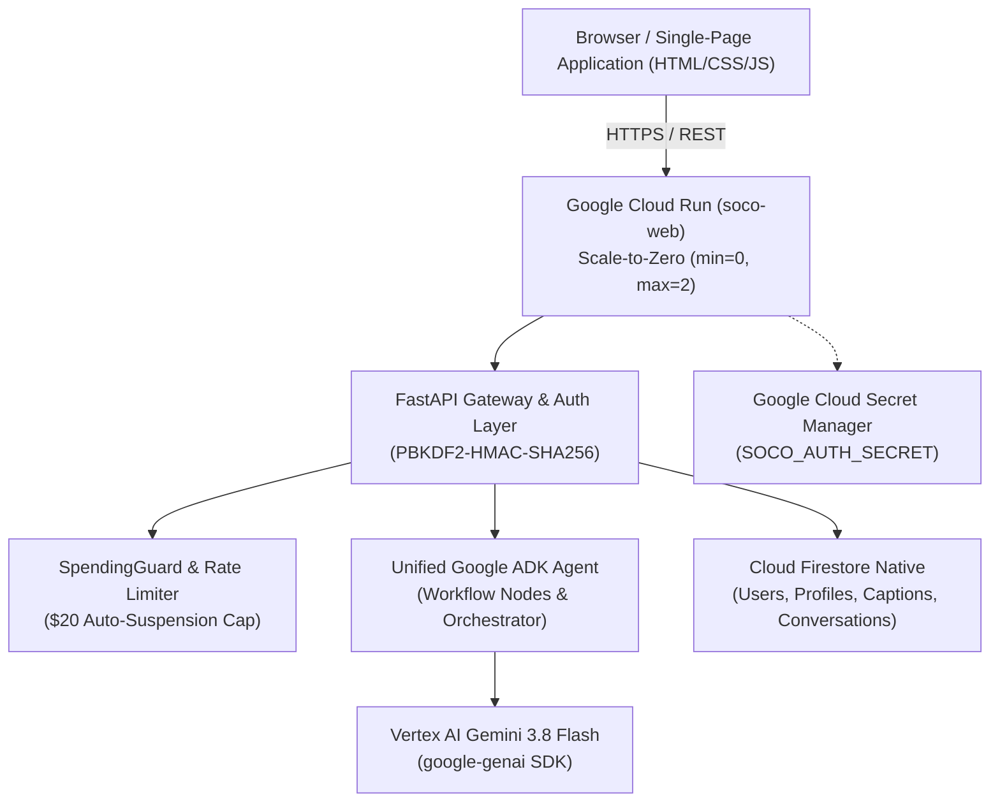

# SoCo — AI-Powered Social Media Strategist & Content Agent

[]()
[-blue.svg)]()
[]()
[-success.svg)]()

> **Live Demo:** [https://soco-web-skcy3yz26q-ue.a.run.app](https://soco-web-skcy3yz26q-ue.a.run.app)

**SoCo** is an autonomous AI social media strategist built on **Google's Agent Development Kit (ADK)** and powered by **Gemini 3.8 Flash on Vertex AI**. Designed specifically for specialized SMB verticals, SoCo bridges the gap between high-level brand strategy and day-to-day post generation—crafting platform-tailored copy, maintaining strict brand voice consistency, conducting human-in-the-loop external news curation, and supporting conversational revisions with full version history.

---

## 🌟 Key Features

- **Conversational AI Content Generation**: Ask for single posts, event announcements, or 30-day monthly strategy calendars.
- **In-Place Conversational Revisions**: Provide feedback like *"Make it punchier and add #FreshPasta"*; SoCo revises the post into `v2` while preserving prior versions in `version_history`.
- **Four Specialized SMB Verticals**: Pre-configured domain knowledge, tone guidelines, regulatory boundaries, and platform affinities for 4 distinct industries.
- **Instant Sandbox Demo Mode**: Test all four industries immediately via the interactive landing page without entering credentials.
- **Private Beta Gating**: Secure registration gated by cryptographic invitation tokens.
- **Human-in-the-Loop News Scanner**: Scans industry news and presents draft proposals that require explicit user approval and platform selection before entering content workflows.
- **Hard Cost Safeguards**: In-app rate limiting (5 req/min), per-business quotas (25 daily, 250 monthly), and an automated hard circuit-breaker halting AI calls when monthly spend reaches $20.00 (within a $25 Google Cloud budget).

---

## 🏢 Supported Industry Verticals

| Industry | Focus Areas & Tone | Primary Platforms |
| :--- | :--- | :--- |
| **Construction / Civil Engineering** | Heavy civil projects, municipal improvements, OSHA job site safety, structural engineering | LinkedIn, Facebook |
| **Nonprofit** | Donor stewardship, volunteer mobilization, fundraising urgency, community impact | Instagram, LinkedIn, Facebook |
| **Restaurant** | Scratch kitchen, seasonal dining, daily specials, food safety, inviting hospitality | Instagram, Facebook |
| **Law** | Statutory compliance, contract protections, appellate precedents, client rights, educational guidance | LinkedIn, Facebook |

---

## 🏗️ Architecture & Technology Stack



### Technology Stack
- **AI Framework**: Google Agent Development Kit (ADK), Google GenAI SDK (`google-genai`)
- **Foundation Model**: `gemini-3.8-flash` via Vertex AI (Global location)
- **Backend**: Python 3.12, FastAPI, Uvicorn, Pydantic v2
- **Persistence**: Google Cloud Firestore Native (`us-east1`)
- **Security & Secrets**: Google Cloud Secret Manager, PBKDF2-HMAC-SHA256 password hashing, HMAC-SHA256 session tokens
- **Frontend**: Vanilla HTML5, CSS3 (Modern design system with accessible contrast and micro-animations), ES6+ JavaScript
- **Hosting & Compute**: Google Cloud Run (`us-east1`, serverless scale-to-zero)

---

## 🛡️ Security & Multi-Tenancy

- **Zero-Trust Multi-Tenancy**: All database queries strictly bind to the verified `business_id` extracted from cryptographically signed session tokens. No tenant can view or mutate foreign business data.
- **Secret Manager Injection**: Authentication signing keys are fetched directly from Google Cloud Secret Manager (`soco-auth-secret`) at runtime—no hardcoded secrets in source control.
- **Admin Isolation**: Demo sandbox accounts are strictly prohibited (`403 Forbidden`) from administrative spending metrics and invitation management.
- **Invitation Protection**: Invitation discovery endpoints are disabled in production (`404 Not Found`). Registrations without a valid cryptographic invitation code are rejected (`403 Forbidden`).

---

## 🧪 Testing

SoCo includes a comprehensive 98-test automated test suite covering unit logic, integration endpoints, multi-tenancy isolation, spending safeguards, and prompt security:

```bash
# Run entire test suite
uv run pytest

# Run with verbose output
uv run pytest -v

# Run unit tests only
uv run pytest tests/unit/
```

**Test Coverage Highlights:**
- `test_security_and_validation.py`: Prompt injection defenses, demo access blocks, tenant isolation, and $20 spending suspension.
- `test_auth_and_invitations.py`: PBKDF2 hashing, invitation token redemption, token verification, and session invalidation.
- `test_conversational_chat.py`: Single-caption requests, conversational revisions, and 30-day strategy matrices.
- `test_gateway_endpoints.py`: REST API contract, profile management, news approvals, and account deletion cascading.

---

## 💻 Local Development Setup

### 1. Prerequisites
- **Python 3.12+**
- **[uv](https://docs.astral.sh/uv/)** (recommended fast package manager)
- **[Google Cloud SDK](https://cloud.google.com/sdk)** (for Vertex AI authentication)

### 2. Installation
```bash
# Clone the repository
git clone https://github.com/washingtongtobia-afk/soco-ai.git
cd soco-ai

# Install dependencies with uv
uv sync
```

### 3. Environment Configuration
```bash
# Copy example configuration
cp .env.example .env

# Configure your Google Cloud Project or Gemini API credentials in .env
```

### 4. Authenticate Google Cloud (for Vertex AI)
```bash
gcloud auth application-default login
```

### 5. Start the Development Server
```bash
uv run uvicorn app.fast_api_app:app --host 127.0.0.1 --port 8000 --reload
```
Open **[http://127.0.0.1:8000/soco](http://127.0.0.1:8000/soco)** to interact with the local workspace.

---

## 📄 License
This project is licensed under the Apache License, Version 2.0.
